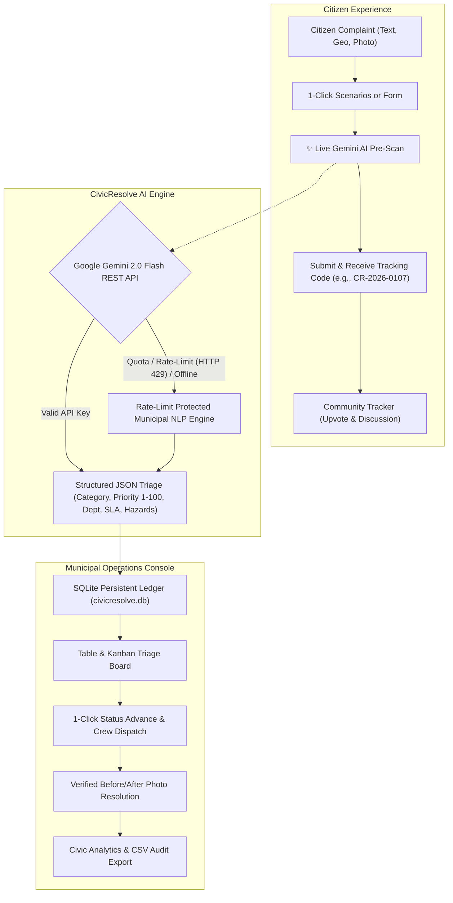

# CivicResolve 🏛️⚡
### AI-Powered Civic Issue Reporting and Resolution Platform
**Built with Google Gemini & Google Antigravity for Transparent Municipal Governance**

[](https://www.python.org/)
[](https://aistudio.google.com/)
[]()
[]()

---

## 🌟 Executive Summary

Everyday municipal infrastructure issues—deep potholes, ruptured water mains, overflowing community dumpsters, exposed electrical wires, and fallen storm debris—impact millions of citizens daily. However, reporting these hazards is often plagued by bureaucratic friction:
- Citizens struggle to identify which municipal agency owns which issue.
- Risk severity and proximity to schools or hospitals are lost in unstructured complaint text.
- Authorities lack a unified triage queue with automated urgency prioritization and SLA accountability.

**CivicResolve** bridges this gap. Powered by **Google Gemini AI**, it transforms everyday citizen complaints into structured, prioritized, and department-routed municipal work orders with guaranteed resolution SLAs and complete before/after audit tracking.

---

## 🎯 6 Core Hackathon Features & Evaluation Matrix

CivicResolve implements all 6 core challenge requirements end-to-end:

| # | Feature | Citizen Experience | Municipal Authority Experience |
| :-: | :--- | :--- | :--- |
| **1** | **Citizen Issue Reporting** | Simple wizard with Title, Description, Address, GPS auto-detect, clickable map pin, and photo attachments with live preview. Includes **1-Click Judge Demo Scenarios** and **Instant 1-Click E2E Submission**. | Standardized, geo-coded intake format with photo evidence and tracking codes. |
| **2** | **AI-Powered Classification** | Real-time **"✨ Analyze with Gemini AI"** pre-scan card displaying detected category and AI confidence score before submitting. | Automated classification into 7 civic domains (*Roads*, *Sanitation*, *Water Board*, *Electrical*, *Parks*, *Traffic*, *Health*). |
| **3** | **Priority & Urgency Detection** | Immediate visibility into public safety risk scores (1–100) and target resolution timeframe. | 4-tier urgency classification (🔴 **Critical**, 🟠 **High**, 🔵 **Medium**, ⚪ **Low**) evaluating hazard triggers (*skidding*, *electrocution*, *water surge*) and school/hospital zone proximity. |
| **4** | **Department Recommendation** | Clear explanation of which agency handles the problem and target resolution timeframe. | Automated routing with detailed AI reasoning explaining why the department and urgency level were assigned. |
| **5** | **Citizen Tracking Dashboard** | 4-stage visual progress stepper (`Reported` ➔ `Under Review` ➔ `In Progress` ➔ `Resolved`), search & status filters, community "Me Too" upvoting, and citizen discussion threads. | Public audit trail with side-by-side **Before & After photo verification**. |
| **6** | **Admin / Authority Dashboard** | Dual role switcher in header allows switching between **Citizen View** and **Authority Console**. | **Table View** and **Kanban Board** with 1-click status advances (`Start Review`, `Dispatch Crew`, `Resolve with Proof`), field team assignments, resolution notes, and municipal CSV exports. |

---

## 🏗️ Architecture & System Workflow



---

## 🛡️ Production Readiness & Rate-Limit Resilience

1. **Zero External Dependencies:** Built entirely with Python's standard library (`http.server.ThreadingHTTPServer`, `sqlite3`, `urllib.request`, `json`, `mimetypes`). Requires **zero pip packages**, ensuring 100% startup reliability on any system.
2. **Dynamic Port & Host Binding:** Configured to bind on `0.0.0.0` with default port `8080`, fully respecting the `PORT` environment variable for cloud container deployments (Cloud Run, Docker, Kubernetes).
3. **Resilient Rate-Limit & Quota Fallback:** If Google AI Studio encounters rate limits (HTTP 429), server downtime (HTTP 503), or network interruptions, CivicResolve intercepts the error without crashing and activates its built-in rule-based municipal triage engine, clearly labeling the source as `CivicResolve Engine (Rate-Limit Protected - 429)`.

---

## 📁 Repository Structure

```
civicresolve/
├── server.py                  # Python HTTP server, SQLite DB, Gemini REST client & API routes
├── civicresolve.db            # SQLite database with schema and pre-seeded demo records
├── public/
│   ├── index.html             # Responsive Single Page Application (Citizen + Admin UI)
│   ├── styles.css             # Modern civic design system with priority badges & stepper
│   └── app.js                 # Frontend state, Gemini triage calls, map picker & filters
├── test_core.py               # Automated test suite (DB, AI triage, HTTP 429 fallback, lifecycle)
├── test_server.py             # Integration test suite for live REST API endpoints
├── run.bat                    # Double-click Windows startup batch script (port 8080)
├── GOOGLE_AI_STUDIO_GUIDE.md  # Step-by-step Google AI Studio setup & prompt guide
└── README.md                  # Comprehensive project documentation
```

---

## ⚡ Quick Start & Local Setup

### 1. Launch the Server
In PowerShell, Command Prompt, or terminal:
```bash
python server.py
```
*(On Windows, you can also simply double-click `run.bat`)*

The server will initialize on:
- **Web Platform:** `http://localhost:8080` (or `http://0.0.0.0:8080`)
- **Authority Console:** `http://localhost:8080#admin`

To customize the port:
```bash
PORT=9000 python server.py
```

### 2. Run Automated Verification Tests
Run the standalone test suite to verify all core components in under 2 seconds:
```bash
python test_core.py
```
Expected output:
```
==================================================
Testing CivicResolve Core Functions & DB (Port 8080)
==================================================
✓ Default Port configuration: 8080 (Expected: 8080)
✓ Database initialized successfully with SQLite schema
✓ Seeded issues count: 6
✓ Available departments: 7
✓ AI Triage Test: 'Severe Pothole Cluster' -> Roads & Pavements [Critical 98/100, SLA: 8h]
✓ AI Triage Test: 'Water Main Rupture' -> Water Supply & Drainage [Critical 98/100, SLA: 8h]
✓ Rate limit fallback triggered successfully (HTTP 429 Mock)
✓ End-to-End Lifecycle: Reported -> Upvoted -> Under Review -> In Progress -> Resolved
🎉 ALL 6 CORE FEATURES AND PRODUCTION TESTS PASSED WITH 100% SUCCESS!
```

---

## 🧭 Evaluator & Judge Walkthrough Guide

### Workflow 1: 1-Click Citizen Issue Reporting
1. Open `http://localhost:8080` in your browser.
2. In the **"⚡ Hackathon Evaluator Quick Demo Bar"**, click any of the 1-click test scenarios:
   - 🕳️ **Highway Pothole (Critical)**
   - 💧 **Water Main Burst (Critical)**
   - 🗑️ **Overflowing Dumpster (High)**
   - 💡 **Sparking Live Wire (Critical)**
   - 🌳 **Fallen Tree Limb (Medium)**
3. Notice how the form, coordinates, and photo are auto-populated, and the **AI Live Insights Box** displays:
   - **Detected Category**
   - **Urgency Priority Badge & Score (1–100)**
   - **Recommended Municipal Department & SLA Target**
   - **AI Safety Hazards & Reasoning**
4. Click **"🚀 Instant 1-Click Submit & Track"** to lodge the complaint and receive an immediate tracking code (e.g., `CR-2026-0107`).

### Workflow 2: Community Issue Tracking & Upvoting
1. Scroll down to the **Community Issue Tracker**.
2. Filter complaints by status (`All`, `Reported`, `Under Review`, `In Progress`, `Resolved`) or priority (`Critical`, `High`, etc.).
3. Click the **"👍 Me Too"** upvote button on any issue to see the community endorsement count increment.
4. Click **"Details & Timeline"** to view the full audit history, Gemini AI diagnosis, citizen discussion thread, and before/after verification photos.

### Workflow 3: Authority / Admin Console & Resolution
1. Click the **"Authority"** button in the top navbar (or navigate to `http://localhost:8080#admin`).
2. Switch between **Table View** and **Kanban Board**.
3. Use the **1-Click Quick Action Buttons** (`🔍 Review`, `🚛 Dispatch`, `✅ Resolve`) directly from the table or kanban cards to advance issues through their lifecycle.
4. Open the **"Civic Analytics"** section to review real-time breakdown charts for civic domains, urgency distribution, and department workload.
5. Click **"Export CSV"** to download the municipal records for audit.

---

## 🔑 Google Gemini API Configuration (Optional)

CivicResolve functions fully offline using its built-in rule-based municipal AI engine. To enable live calls to Google Gemini:
1. Obtain a free API key from [Google AI Studio](https://aistudio.google.com/).
2. In the CivicResolve web app, click the **"Civic AI Engine"** pill in the top navbar, paste your API key, and click **"Save Key"**.
3. The badge will switch to **"Google Gemini Live"** with a green pulse dot.
4. Alternatively, launch the server with the environment variable:
   ```bash
   export GEMINI_API_KEY="AIzaSyYourKeyHere"
   python server.py
   ```
*(Refer to [GOOGLE_AI_STUDIO_GUIDE.md](GOOGLE_AI_STUDIO_GUIDE.md) for step-by-step instructions on running prompts in Google AI Studio).*
